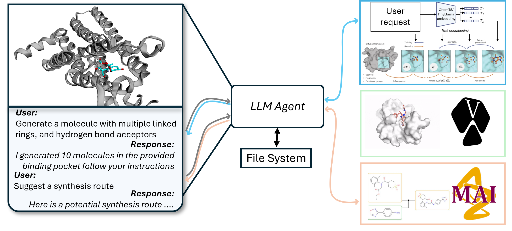
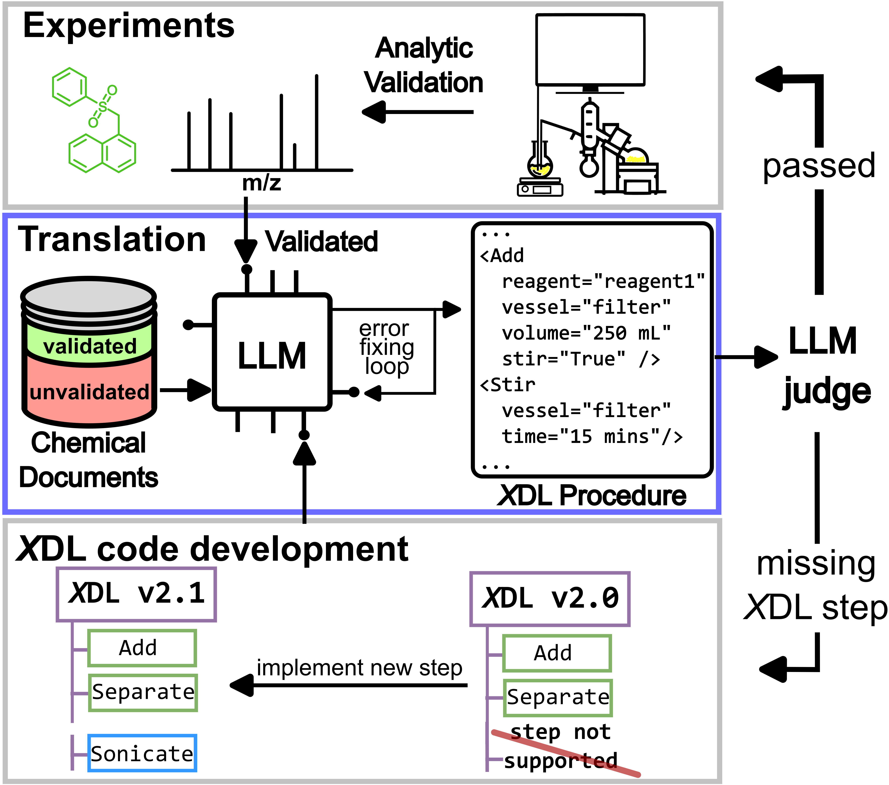
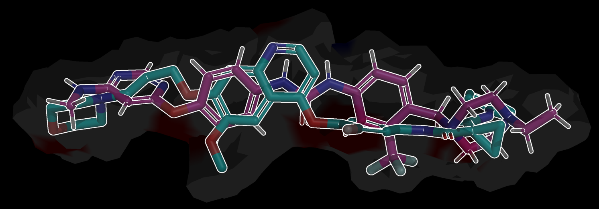
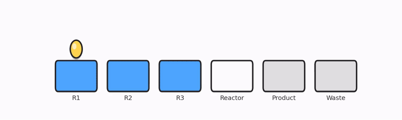
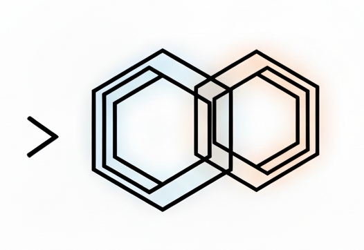
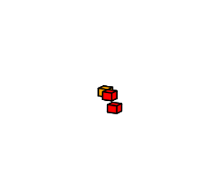
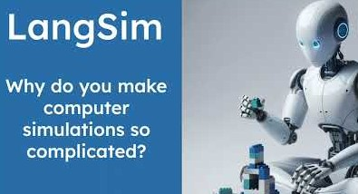
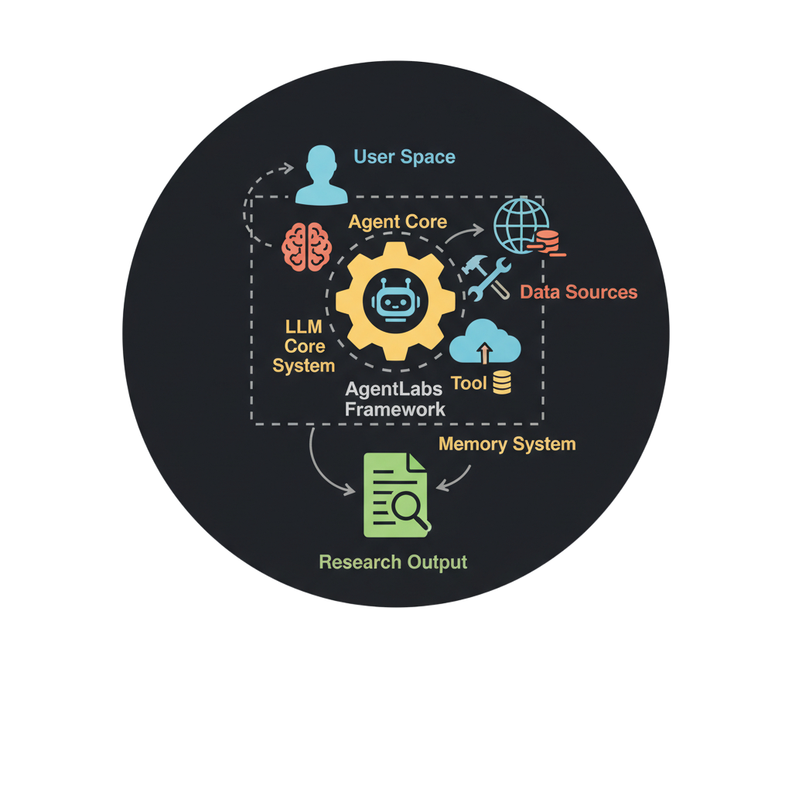

# Sebastian Pagel

  

---

## About

I am a computational chemist and AI researcher at the University of Glasgow working at the intersection of **machine learning, large language models, and chemical discovery**.

My work focuses on building **autonomous, agent-based systems** that integrate retrieval, reasoning, and tool-use to solve complex scientific problems. I design and deploy AI systems that connect:

- **Unstructured knowledge** (scientific literature)
- **Structured workflows** (molecular design, synthesis, experimentation)

I am particularly interested in:
- **LLM-driven reasoning and multi-agent systems**
- **Generative models for molecular design**
- **End-to-end AI pipelines for real-world discovery**
- **Bridging AI systems with experimental and robotic platforms**

---

##  Highlighted Systems

- **ACRA — Autonomous Chemical Reasoning Agent**  
  Multi-agent LLM system translating scientific literature into executable synthesis workflows  
  → RAG + planning + tool-use + self-correction  

- **MIDAS**  
  Language-controlled 3D molecular generation with spatial reasoning  
  → LLMs interacting directly with molecular representations  

- **LangSim**  
  Agent-based framework for automated materials discovery  
  → Orchestrates multi-step scientific workflows  

---

## Research Interests

- LLMs and **agent-based systems for scientific reasoning**  
- Machine learning for molecular generation and property prediction  
- Chemical space exploration and drug design (LBDD / SBDD)  
- Autonomous and closed-loop discovery systems  
- Scientific software, data pipelines, and reproducibility  

---

## Technical Expertise

<strong>Programming Languages</strong>

  
  
  
  

<strong>Machine Learning & AI Systems</strong>

  
  
  

- Multi-agent LLM systems (ReAct, tool-use, planning)  
- Retrieval-Augmented Generation (RAG), vector databases  
- LLM evaluation and self-correction (LLM-as-a-judge)  

<strong>Computational Chemistry</strong>

  
  
  
  

- Ligand- and structure-based drug design  
- Molecular dynamics and simulation  
- Chemical dataset curation and analysis  

## Selected Projects and Publications

<table>
  <tr>
    <td width="220" align="center">
      
    </td>
    <td align="left">
      <a href="https://github.com/pagel-s/midas"><b>Midas</b></a> 
      Agentic interface for language-controlled 3D molecular generation and manipulation   
      
      
    </td>
  </tr>

  <tr>
    <td width="220" align="center">
      
    </td>
    <td align="left">
      <a href="https://arxiv.org/abs/2410.06384"><b>ACRA</b></a> 
      Multi-agent LLM workflow for automated synthesis planning and execution from scientific literature  
      
      
      
    </td>
  </tr>

  <tr>
    <td width="220" align="center">
      
    </td>
    <td align="left">
      <a href="https://github.com/pagel-s/spalt"><b>Spalt</b></a> 
      Alignment of Ligand Topographies using molecular surface features.  
      
      
    </td>
  </tr>

  <tr>
    <td width="220" align="center">
      
    </td>
    <td align="left">
      <a href="https://github.com/croningp/molecular_spaces"><b>Molecular Spaces</b></a> 
      Quantification of selection in chemical spaces and denovo molecular generation using Assembly Theory.  
      
      
      
    </td>
  </tr>

  <tr>
    <td width="220" align="center">
      
    </td>
    <td align="left">
      <a href="https://github.com/croningp/chemputation/"><b>Chemputation</b></a> 
      Chemputer and Chemputation -- A Universal Chemical Compound Synthesis Machine.  
      
      
      
    </td>
  </tr>

  <tr>
    <td width="220" align="center">
      
    </td>
    <td align="left">
      <a href="https://github.com/pagel-s/molgrep"><b>molgrep</b></a> 
      CLI SMARTS based molecule retrieval   
      
      
    </td>
  </tr>

  <tr>
    <td width="220" align="center">
      
    </td>
    <td align="left">
      <a href="https://github.com/croningp/molnca"><b>MolNCA</b></a> 
      Neural Cellular Automata for molecule generation.  
      
      
      
    </td>
  </tr>

  <tr>
    <td width="220" align="center">
      
    </td>
    <td align="left">
      <a href="https://github.com/jan-janssen/LangSim"><b>LangSim</b></a> 
       LLM-driven agent framework for orchestrating materials simulation workflows  
      
      
      
    </td>
  </tr>

  <tr>
    <td width="220" align="center">
      
    </td>
    <td align="left">
      <a href="https://github.com/pagel-s/agentlabs"><b>AgentLabs</b></a> 
      Framework for autonomous lab agents and experimentation.  
      
      
    </td>
  </tr>
</table>

  

---

## Contact

- GitHub: https://github.com/pagel-s
- Google Scholar: https://scholar.google.com/citations?hl=en&user=cq0VR8wAAAAJ
- LinkedIn: https://www.linkedin.com/in/sebastian-pagel-5a0b71148/

  <i>
    From <a href="https://github.com/pagel-s" target="_blank">pagel-s</a> | PhD Researcher at University of Glasgow
  </i>

  

